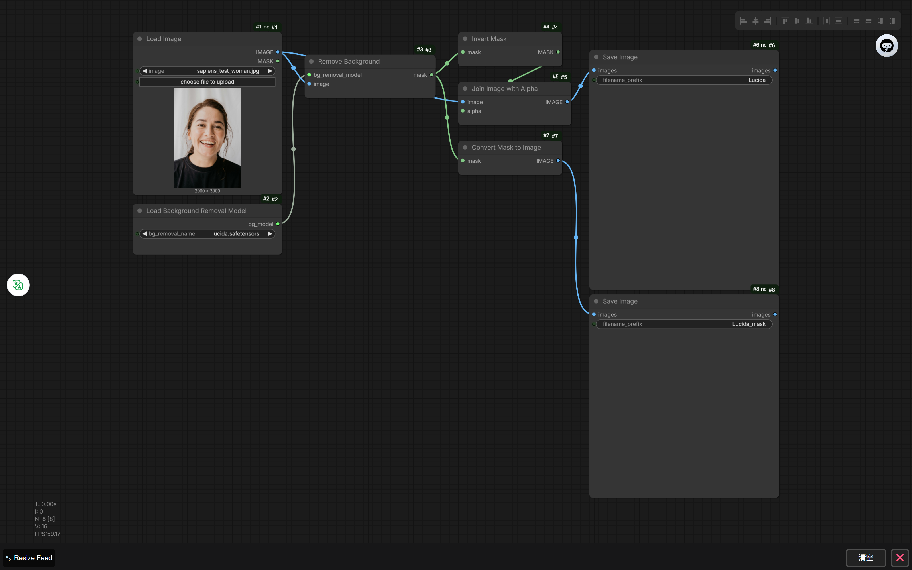
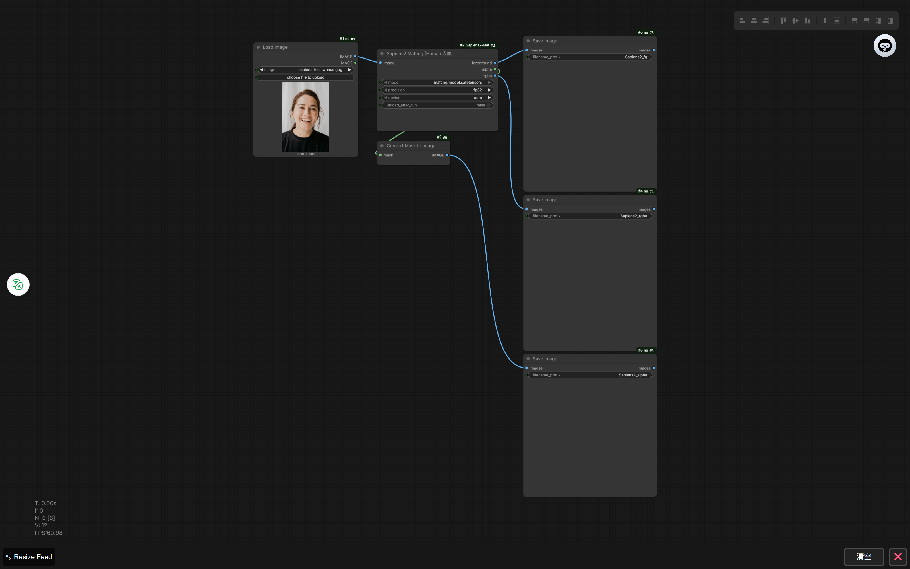
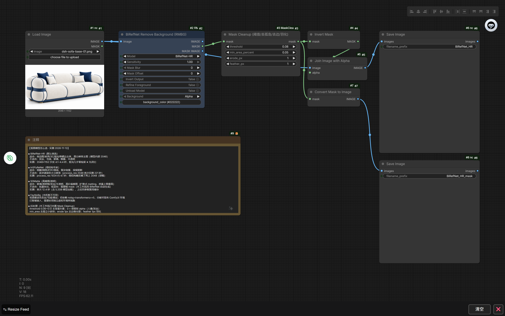
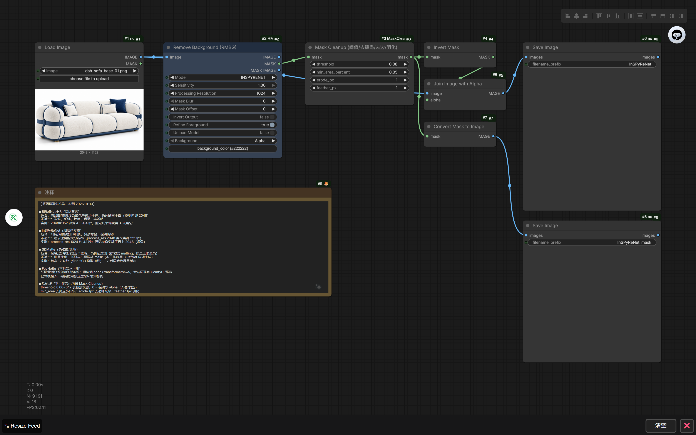
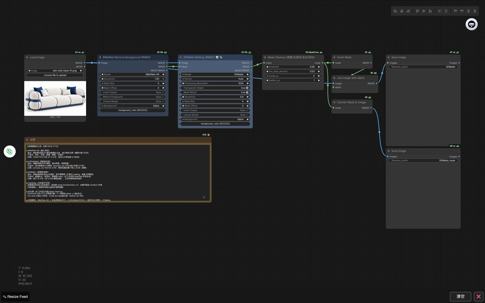

# ComfyUI 抠图工作流（个人使用）

> 这是个人使用整理的 ComfyUI 抠图工作流合集，共 5 个，覆盖商品图、人像、透明物、发丝、复杂细结构。
> 每个工作流都自带 **Mask 清理**（阈值 / 去孤岛 / 去边 / 羽化），并在工作流内用 **Note 节点**写明适用场景与参数。

> 配套节点插件（Mask Cleanup + MiniMax H3 比例选择器）：
> **[comfyui-node-toolkit](https://github.com/LZM2023/comfyui-node-toolkit)**
> 三个新版工作流使用其中的 **Mask Cleanup** 节点；SDMatte / BiRefNet-HR / InSPyReNet 节点来自
> **[ComfyUI-RMBG](https://github.com/1038lab/ComfyUI-RMBG)**（v3.3.0+）。

---

## 5 个工作流一览

| 工作流文件 | 模型 | 最佳用途 | 实测（2048×1152 沙发） |
|---|---|---|---|
| `Lucida 抠图（BiRefNet）.json` | Lucida（MIT） | 玻璃/透明、文字 logo、插画、印花 | 约 1.2 秒（有低 alpha 残留，建议配合清理） |
| `Sapiens2 人像抠图（软 alpha）.json` | Sapiens2-1B（Meta） | **人像**发丝、软 alpha、预乘前景 | 首次 14 秒 / 缓存后 2.3 秒（仅人像） |
| `抠图 · BiRefNet-HR（商品图首选）.json` | BiRefNet-HR（MIT） | 商品图、家具、3C、鞋包等硬边主体 | **4.1–4.4 秒**，零残留 |
| `抠图 · InSPyReNet（细结构）.json` | InSPyReNet（MIT） | 细腿/网格/栏杆/细线/复杂背景 | 1024：4.1 秒；**2048：221 秒（勿默认）** |
| `抠图 · SDMatte（透明发丝高难）.json` | SDMatte（OpenRAIL++） | 玻璃/透明/发丝/半透明高难图精修 | 约 13.2 秒（含 5.2GB 加载） |

**选择顺序**：BiRefNet-HR → 细结构不行换 InSPyReNet(1024) → 透明/发丝/高难用 SDMatte；人像用 Sapiens2；插画/文字/玻璃用 Lucida。

---

## 工作流截图

### 1. Lucida 抠图（BiRefNet）



核心 `Load Background Removal Model` + `Remove Background`，输出 mask 后经 `Invert Mask` → `Join Image with Alpha` 合成透明 PNG。适合玻璃/文字/插画，大图细节一般，商品图更推荐 BiRefNet-HR 工作流。

### 2. Sapiens2 人像抠图（软 alpha）



`Sapiens2 Matting (Human 人像)` 节点输出前景 / alpha / RGBA 三路，分别保存。仅对人像有效；输入固定 1024×768 竖构图。

### 3. 抠图 · BiRefNet-HR（商品图首选）



`BiRefNet (RMBG)` 选 `BiRefNet-HR`（内部 2048）→ `Mask Cleanup`（threshold 0.08 / erode 1 / feather 1）→ 合成透明图 + mask。商品图首选。

### 4. 抠图 · InSPyReNet（细结构）



`Remove Background (RMBG)` 选 `INSPYRENET`，`process_res` 默认 1024（2048 极慢）→ `Mask Cleanup`。适合细腿/网格/复杂背景。

### 5. 抠图 · SDMatte（透明/发丝/高难）



先用 `BiRefNet (RMBG)` 生成粗 mask，再交给 `SDMatte (RMBG)` 精修，最后 `Mask Cleanup`。透明/发丝/半透明高难图质量上限最高，速度较慢。

---

## 一、安装节点

### 1) 核心（Lucida 工作流只需要它）

ComfyUI 0.45+ 自带 `Load Background Removal Model` / `Remove Background` / `Invert Mask` / `Join Image with Alpha` / `Mask To Image`，无需额外安装。

### 2) ComfyUI-RMBG（BiRefNet-HR / InSPyReNet / SDMatte 工作流需要）

```bash
cd ComfyUI/custom_nodes
git clone https://github.com/1038lab/ComfyUI-RMBG.git
```

> ⚠️ 该仓库的 `requirements.txt` 没有锁版本，部分启动器会自动
> `pip install -r` 并把 `transformers` 升到 5.x，导致 QwenVL / Florence-2 等节点异常。
> 建议先看 [docs/TROUBLESHOOTING.md](docs/TROUBLESHOOTING.md)，或使用 `scripts/requirements-rmbg-safe.txt` 安装。

### 3) ComfyUI-Node-Toolkit（Mask Cleanup）

```bash
cd ComfyUI/custom_nodes
git clone https://github.com/LZM2023/comfyui-node-toolkit.git
```

> 如果你本机已单独安装过 `ComfyUI-MaskCleanup` 或 `minimax-h3-image-aspect-selector`，
> 请**二选一**，不要同时保留（同名节点会冲突）。

### 4) Sapiens2 工作流的配套节点（本仓库已附带）

把 `custom_nodes/ComfyUI-Sapiens2-Matting/` 整个文件夹复制到 `ComfyUI/custom_nodes/`：

```bash
copy custom_nodes\ComfyUI-Sapiens2-Matting  <ComfyUI>\custom_nodes\   # Windows
# cp -r custom_nodes/ComfyUI-Sapiens2-Matting <ComfyUI>/custom_nodes/  # Linux/macOS
```

重启 ComfyUI。

---

## 二、下载模型（重点）

> 所有文件都可以用 `scripts/download_models.ps1` 一键下载到正确目录。
> 完整清单（URL / 大小 / SHA256 / 目标目录）见 **[docs/MODELS.md](docs/MODELS.md)**。

| 模型 | 下载地址（HuggingFace） | 放到 |
|---|---|---|
| Lucida | [Comfy-Org/BiRefNet · background_removal/lucida.safetensors](https://huggingface.co/Comfy-Org/BiRefNet/resolve/main/background_removal/lucida.safetensors) | `ComfyUI/models/background_removal/lucida.safetensors` |
| BiRefNet-HR | [1038lab/BiRefNet](https://huggingface.co/1038lab/BiRefNet)：`birefnet.py`、`BiRefNet_config.py`、`config.json`、`BiRefNet-HR.safetensors` | `ComfyUI/models/RMBG/BiRefNet/` |
| InSPyReNet | [1038lab/inspyrenet · inspyrenet.safetensors](https://huggingface.co/1038lab/inspyrenet/resolve/main/inspyrenet.safetensors) | `ComfyUI/models/RMBG/INSPYRENET/inspyrenet.safetensors` |
| SDMatte | [1038lab/SDMatte · SDMatte.safetensors](https://huggingface.co/1038lab/SDMatte/resolve/main/SDMatte.safetensors) + 组件 configs | `ComfyUI/models/RMBG/SDMatte/`（子目录见 docs/MODELS.md） |
| Sapiens2-1B | [facebook/sapiens2-matting-1b · model.safetensors](https://huggingface.co/facebook/sapiens2-matting-1b/resolve/main/model.safetensors) | `ComfyUI/models/sapiens2/matting/model.safetensors` |

```powershell
# Windows 一键下载（默认从 hf-mirror.com 镜像站，可换 -Mirror https://huggingface.co）
powershell -ExecutionPolicy Bypass -File scripts\download_models.ps1 -ComfyUI "D:\ComfyUI-aki-v2\ComfyUI"
```

---

## 三、安装工作流

1. 把 `workflows/` 下的 5 个 `.json` 复制到 `ComfyUI/user/default/workflows/`
2. 重启 ComfyUI → 左侧「工作流」里打开对应文件
3. 每个工作流里的 **Note 节点**已写明四个模型的适用场景、实测耗时和参数建议

---

## 四、通用结构与参数

```
Load Image → 抠图模型 → Mask Cleanup → Invert Mask → Join Image with Alpha → Save Image（透明 RGBA）
                                 └→ Mask To Image → Save Image（mask）
```

- **Mask Cleanup**（来自 comfyui-node-toolkit）
  - `threshold`：0 = 保留软 alpha（人像/发丝）；0.06–0.12 = 硬阈值，去背景灰雾（商品图推荐 0.08）
  - `min_area_percent`：去孤立小碎块（默认 0.05）
  - `erode_px`：向内收缩 1px，去边缘光晕
  - `feather_px`：羽化 1px
- **SDMatte 工作流**先用 BiRefNet-HR 生成粗 mask，再交给 SDMatte 精修。
- **Sapiens2** 仅对人像有效，且输入固定 1024×768（竖构图）。

细节见 [docs/WORKFLOWS.md](docs/WORKFLOWS.md)。

---

## 五、常见问题

见 [docs/TROUBLESHOOTING.md](docs/TROUBLESHOOTING.md)，包括：

- `Join Image with Alpha` 的 mask 方向问题（必须先 `Invert Mask`）
- transformers 被启动器升级到 5.x 的修复
- `process_res` 对速度的影响（InSPyReNet 2048 极慢）
- 模型放错目录 / 文件名不对导致节点找不到模型

---

## 六、许可

- 本仓库的工作流 JSON 与文档：**MIT**
- ComfyUI-RMBG 节点代码：GPL-3.0（另行安装）
- comfyui-node-toolkit：MIT（另行安装）
- Sapiens2 配套节点：封装 MIT + `sapiens/` 代码受 **Sapiens2 License** 约束（见附带 `LICENSE_SAPIENS2.md`）
- 模型权重：Lucida MIT / BiRefNet MIT / InSPyReNet MIT / SDMatte OpenRAIL++ / Sapiens2 自定义许可（允许商用但禁止监控、生物识别、深伪等）

**本仓库不包含任何模型权重**，所有模型需按上面的地址自行下载。
